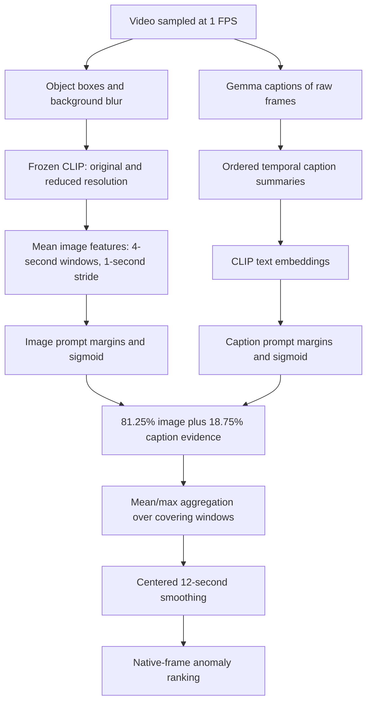

**Paper readiness review — 27 October 2026**

The project is ready for a professor discussion and has a plausible path to a paper. I would not submit the current evidence as a validated novel architecture or generalization result yet. The main gaps are independent evaluation, a precise contribution relative to prior work, and controlled experiments on the final model. Publication does not require adding more modules or beating every published method; it does require a useful, well-supported contribution appropriate to the venue. Acceptance cannot be predicted from benchmark scores alone.

This review inspected the implementation, configurations, saved reports and predictions metadata, and primary research sources. It reran the software suite: **154 passed, 1 GPU-dependent test skipped**. CUDA was unavailable to that test. It did not rerun video feature extraction, caption generation, or a new benchmark. Existing results below remain recorded development measurements.

**What is actually supported now**

| Evidence | Current result | Interpretation |
|---|---|---|
| UCF-Crime, 290 supplied videos | 83.1203% pooled native-frame ROC-AUC | Development result; the benchmark influenced selection |
| XD-Violence, 800 supplied videos | 71.7558% pooled native-frame AP; 90.1088% ROC-AUC | Development result; AP and ROC-AUC are different metrics |
| Same selected configuration | Same prompts, fusion, smoothing and scoring settings on both datasets; no reference bank | Shows shared settings were used; does not establish transfer to an unseen domain |
| UCF threshold behavior | 16.49% frame precision, 84.20% recall, 27.58% F1 | Current ranking performance does not establish a usable alert policy |
| XD threshold behavior | 60.70% frame precision, 82.18% recall, 69.82% F1 | Also conditional on exposed benchmark data and the inherited threshold |
| Statistical comparison with our original model | UCF gain interval includes zero; XD gain interval is positive | Conditional, descriptive source-group bootstrap; does not account for search uncertainty |
| Reproduction artifacts | Configurations, feature caches, captions, per-frame scores, search reports and checks | A useful foundation; fresh raw-video reproduction is still needed |

Sources: [selected results](../outputs/shared_model_evaluation/20261026/summary.json), [selection/provenance](SHARED_MODEL_SEARCH.md), [paired comparison](../outputs/results/shared_model_comparison_20261026/report.md). Frame precision is not precision per alert episode. The confidence intervals compare against our original detector, not against LAVAD or another published method.

**Present the evaluated architecture**

The selected configuration is [shared_best.yaml](../config/shared_best.yaml), while the default configuration still identifies an older memory-based model. Always name the configuration beside a result.

The selected result does not use domain familiarisation, a normal-memory bank, an event hierarchy, the experimental temporal transformer, or final LLM verdict review. Older sections of [README.md](../README.md), [PROJECT_STATUS.md](PROJECT_STATUS.md) and [WINDOW_PIPELINE.md](WINDOW_PIPELINE.md) describe other versions. Reconcile these before reusing them as presentation material.

A defensible description is: **an offline video anomaly ranking system using frozen pretrained models and a shared configuration without a reference memory bank**. Neural weights are frozen, but prompts and hyperparameters were selected using labels. Do not claim label-free development, verified unseen-domain generalization, real-time performance, or state of the art from the current evidence.

**Publication blockers and how to address them**

1. **Test-set influence.** Both benchmarks influenced development; thousands of recipes were explored. A new random split, another replay, or more bootstrap draws cannot undo this. Preserve current numbers as exploratory results. Freeze the method and selection procedure, then evaluate on genuinely untouched source videos or an untouched dataset. If additional tuning is needed, use a separate development partition. Keep movies/cameras/source recordings and near-duplicates in one partition. For a transfer claim, the target evaluation data must not choose the prompts, weights, smoothing or threshold.

2. **Unproven novelty.** Frozen models, captions, textual anomaly descriptions and temporal refinement already occur in published work. Write one falsifiable contribution statement and explain how it differs. A candidate research question is whether a fixed image/caption scoring rule gives a reproducible accuracy-versus-cost advantage across domains without a reference bank. That is a hypothesis to test, not an established finding. A careful empirical analysis or efficient system can also be a contribution; a new diagram alone is insufficient.

3. **Dataset/protocol verification.** The audit compared all normalized filename/category/coordinate records in the local UCF annotation file with the [original authors' release](https://raw.githubusercontent.com/WaqasSultani/AnomalyDetectionCVPR2018/master/Temporal_Anomaly_Annotation.txt): **290 rows in each, with no missing, extra or different records**. Therefore, neither the local Five_FPS filename nor another paper saying 300 establishes a split or coordinate error. Saved UCF metadata records 30 FPS. Video identity/transcoding history and visible event alignment remain to be verified: check duration, temporal content and annotation boundaries together, and record endpoint corrections and exclusions. Replay of saved labels cannot independently validate their original visual alignment. Perform equivalent provenance checks for XD-Violence.

4. **Missing controlled comparisons on the final model.** The existing [saved-score ablations](../outputs/results/score_ablations_20261026/report.md) concern the older memory-based model, not the final 83.12%/71.76% configuration. Search leaderboards are useful development evidence but are not a replacement for isolating component effects. Reproduce simple baselines and the closest prior methods under matched splits and metric code. Clearly distinguish reproduced scores from numbers quoted from papers.

5. **Unmeasured practical tradeoffs.** Centered smoothing uses future information, and processing buffers a full video. Offline evaluation is a valid scope; causal operation is an additional research requirement only if streaming is claimed. The current inherited threshold is not a validated false-alarm policy. Measure runtime and memory including the expensive caption stage; cached rescoring speed is not end-to-end inference speed.

**Minimum experiment plan**

Predeclare the primary metrics, comparisons and selection rule. Use the same evaluation population for each paired comparison; retain the official pooled frame metric and add complementary analyses rather than replacing it.

| Experiment | Question it answers | Work required |
|---|---|---|
| Simple CLIP prompt baseline; image-only; caption-only; equal fusion; selected fusion | Does the combination improve on a simple baseline, and is Gemma worth its cost? | Mostly saved-feature scoring; genuine speed comparison needs extraction without the omitted branch |
| Original/selected prompts crossed with max/log-mean-exp reduction | Is the gain from wording, aggregation, or both? | Saved features plus prompt encoding |
| Mean-only vs mean/max overlap; smoothing off vs selected smoothing | Does temporal postprocessing help, and does it spread scores beyond event boundaries? | Saved window predictions |
| Masking off/on; single/two-resolution image encoding | Do the spatial components justify their complexity? | Fresh visual inference |
| Middle-frame caption, frame captions, temporal summary | Does temporal language aggregation add reliable evidence? | Fresh caption variants as needed |
| Sampling/window/stride sensitivity on development data | Which short or fast events are lost? | New extraction for changed sampling/window design |
| Prompt paraphrases, prompt count and omitted anomaly categories | How dependent is performance on wording and benchmark taxonomy? | Fixed development variants; disclose all tested alternatives |
| Untouched external evaluation after freezing | Does the selected method generalize? | New data and final inference; no subsequent tuning on that test |
| Runtime, peak RAM/VRAM and stage timings | What is the accuracy/cost tradeoff? | Representative raw-video runs on named hardware |

For the final independent comparison, use paired bootstrap intervals over independent videos/source groups, not independent frames. The existing 200 draws are exploratory. Use enough draws to make interval endpoints stable, for example 1,000–2,000 if feasible, while stating the resampling unit and assumptions. More draws do not fix test-set selection. Repeat stochastic caption generation where relevant; deterministic cached replay alone does not measure model or data variability.

Choose an alert threshold on development data under a stated objective, then freeze it. Report precision/recall/F1, false alert episodes per hour of normal footage, event recall and detection delay if causal operation is evaluated. Specify how adjacent positive frames become an alert episode and how detections match annotated events. Do not interpret sigmoid scores as calibrated probabilities without calibration evidence.

**Architectural limits to test or explicitly retain**

- At 1 FPS, brief actions can disappear between samples. Mean-pooled CLIP features do not represent motion order. Audit performance by event duration and compare temporal order perturbations if temporal understanding is claimed.
- The anomaly prompts define a restricted vocabulary. Running, sports, crowds, police presence and controlled fire can resemble anomalies. Test ambiguous normal scenes and categories absent from the prompt bank.
- Gemma can omit or invent actions. Review raw video alongside captions for true detections, false positives and misses; record omissions and unsupported statements. Generated text alone is not proof of faithful explanation.
- The visual branch blurs outside detected boxes; tracking IDs and trajectories are not used for action reasoning. Captions use raw frames, so background remains available to that branch. Test masking benefits and detector-failure rates before claiming background invariance or actor tracking benefits.
- The two-resolution encoder averages original and reduced-resolution embeddings. It is not a learned multiscale reasoning module. Its benefit needs measurement.
- No audio or explicit motion backbone is used. These are possible extensions, not prerequisites for publication. Compare fairly with methods that use additional modalities.

**What to collect and freeze before the final experiment**

| Artifact | Required detail |
|---|---|
| Data manifest | Exact video identities and hashes, source group, duration, frame count, FPS/time mapping, annotation source/version, split membership, duplicate checks, exclusions |
| New labels, if collecting data | Event definitions; start/end times; representative normal footage; source/camera and conditions; annotation disagreements and adjudication; preferably independent reviewers on an audited subset |
| Method snapshot | Code commit, final YAML, all prompts, weights/temperatures, projection/smoothing, threshold, freeze date and complete search ledger |
| Environment and models | Dependency lock or container; Python/CUDA/Ollama versions; CLIP and YOLO revisions/checksums; Gemma digest/quantization; caption prompt templates and generation parameters |
| Predictions | Raw captions, image/text embeddings where redistribution permits, window evidence, final frame scores, per-video metrics and scripts producing tables/figures |
| Compute | Hardware, decode/masking/CLIP/caption/projection time, peak memory, failures/retries, inference cost and development-search cost |
| Reproduction check | A fresh raw-video run matching the final scoring/projection path and a documented command that another person can execute |

Current configuration/model hashes are useful but do not cover every checkpoint, dependency and preprocessing detail. Requirements are mostly unpinned. The saved-feature evaluator and the demo also expose different outputs: the demo prints window results, while benchmark scores include final projection and smoothing. Establish one documented route from raw video to the reported frame scores.

New footage must be representative of the intended setting and contain enough independent events and normal duration for useful uncertainty estimates; a few selected successful demos cannot establish performance. Check permitted use and redistribution of datasets/models and obtain required permissions for new footage. Define observable anomalous events rather than inferring personal intent or identity from appearance.

**What to take to the professor now**

Prepare a short presentation, approximately eight slides:

1. Problem, intended setting and one precise research question.
2. Closest prior methods and the proposed difference.
3. The actual selected architecture, including the score formula and offline scope.
4. Datasets, metric definitions and model-selection history, including benchmark exposure.
5. Current results, uncertainty and alert metrics, labeled development results.
6. Two successes, two false positives and two misses, with video timestamps, annotations, captions and score curves. Mark this as illustrative rather than representative evaluation.
7. Limitations and the smallest experiment matrix needed to test the contribution.
8. Decisions needed: paper type/venue fit, untouched-data access, annotation help, compute budget and milestone ownership.

Bring the configuration, saved reports and a reproducible recorded demo as backup. Do not make the meeting depend on a large model starting successfully. State the boundary of the result plainly: “The same frozen-model configuration was evaluated on both datasets, but both benchmarks influenced development; independent generalization remains to be tested.”

Before the meeting, align the diagram and documentation, verify representative annotation boundaries, prepare the figures/examples, and write a one-page contribution-and-experiment plan. The entire publication experiment matrix can follow the professor's feedback. Before submission, complete the independent evidence and baseline/ablation work appropriate to the claims, then check the chosen venue's current formatting, authorship, anonymity and disclosure rules.

**Prior work to discuss**

| Source | Why it matters |
|---|---|
| [LAVAD, CVPR 2024](https://openaccess.thecvf.com/content/CVPR2024/papers/Zanella_Harnessing_Large_Language_Models_for_Training-free_Video_Anomaly_Detection_CVPR_2024_paper.pdf) | Already combines pretrained captions, language-based temporal scoring and refinement. Its reported UCF AUC 80.28% and XD AP 62.01% are historical reference values; our larger development values do not establish controlled superiority. |
| [HVLMCLD-VAD, 2026](https://doi.org/10.1016/j.knosys.2026.115466), [author implementation](https://github.com/MR81224/HVLMCLD-VAD) | Hierarchical visual/text representations and description dictionaries; compare the relevant training-free variant and match metric definitions. |
| [VERA, CVPR 2025](https://openaccess.thecvf.com/content/CVPR2025/papers/Ye_VERA_Explainable_Video_Anomaly_Detection_via_Verbalized_Learning_of_Vision-Language_CVPR_2025_paper.pdf) | Frozen weights coexist with label-guided verbal prompt learning; distinguish supervision and prompt optimization from neural-weight training. |
| [VADTree, 2025](https://arxiv.org/abs/2510.22693) | Relevant to hierarchical event duration and temporal refinement claims. |
| [Probe-VAD, September 2026 preprint](https://arxiv.org/abs/2609.17211) | Recent work on probing a frozen VLM directly, including the risk of losing evidence through captions; distinguish preprint status. |

Use original metric definitions rather than copying secondary tables. In particular, XD AP and XD ROC-AUC must remain separate, and visual-only/extra-modality, frozen-weight/prompt-learned, reference-memory/no-reference, and offline/causal settings should be identified.

The [NeurIPS paper checklist](https://neurips.cc/public/guides/PaperChecklist) is a useful general preparation reference for matching claims to evidence, explaining selection and uncertainty, documenting reproducibility and reporting compute. It is not a requirement to target that venue or a guarantee of acceptance.
